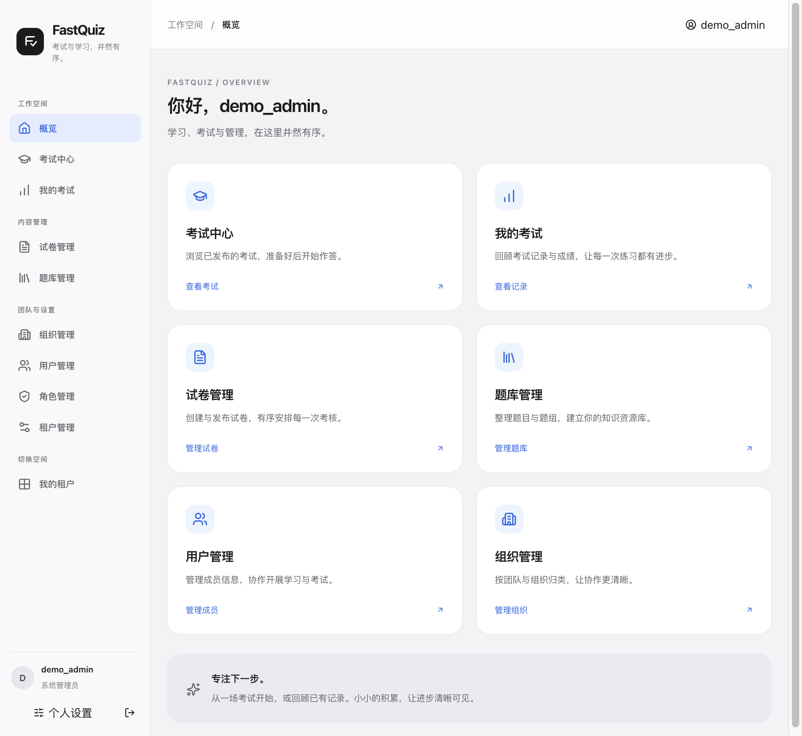

<p align="center">
  
</p>

# FastQuiz

> 考试与学习，井然有序。

FastQuiz 是一套多租户题库、在线考试与阅卷系统，围绕“组织成员 → 管理题库 → 按规则组卷 → 考生作答 → 自动与人工阅卷 → 查看成绩”提供完整的核心流程，适用于课程测验、培训考核和题库练习等场景。

前端采用 **Nuxt 4 / Vue 3**，后端采用 **ASP.NET Core 10**。支持 SQLite、PostgreSQL、MariaDB 数据库配置，默认从 SQLite 起步。

[界面预览](#界面预览) · [主要功能](#主要功能) · [运行逻辑](#运行逻辑) · [快速开始](#快速开始) · [测试与构建](#测试与构建) · [生产部署](#生产部署) · [文档导航](#文档导航)

## 界面预览

### 登录页面

简洁的登录表单、密码显示切换，以及统一的品牌标记。


### 登录后的工作空间概览

从概览进入考试中心、作答记录、试卷、题库和成员管理；管理入口根据当前租户中的权限显示。



截图来自当前前端的本机演示环境，使用虚构身份 `demo_admin`，不包含生产地址、真实账号或业务数据。概览图以浏览器缩放展示完整页面；截图用于介绍界面，不代替真实后端验收。

## 主要功能

| 模块 | 当前能力 |
| --- | --- |
| 账号与租户 | 登录、注册、个人资料、租户切换；系统管理员可将已有账号加入其他租户，保留原账号与密码 |
| 组织与角色 | 组织及成员管理、角色权限配置与分配；考试可限定参加组织，后台操作由服务端校验权限 |
| 题库 | 题组与题目管理，单选、多选、填空题，难度及标准答案配置，前端 CSV 导入入口 |
| 组卷与发布 | 按题组、题型、难度、数量及每题分值抽题，生成试卷快照，发布与取消发布 |
| 答卷与作答 | 即时创建个人答卷或领取预生成答卷，参加次数与时间限制，倒计时、答案保存、交卷 |
| 阅卷 | 选择题自动判定；填空支持精确、包含、正则和人工匹配；人工题全部判定后才允许完成阅卷 |
| 成绩 | 本人历史记录、管理员成绩列表、用户名展示、完整答案查看、最好成绩筛选及 CSV 导出 |
| 运行保障 | 答案请求内事务落库、数据库锁协调答题与交卷、持久化后台任务、健康检查及可配置文件日志 |

CSV 导入入口复用逐条接口，不代表服务端提供了整批原子事务。完整功能状态与后续计划见[页面需求](content.md)和[重构行动清单](docs/refactor-harden-roadmap.md)。

## 运行逻辑

```text
题库与标准答案
      ↓ 按抽题规则选题
考试模板 → 试卷快照
               ↓ 即时生成 / 预生成后领取
            个人答卷
               ↓ 开始、保存答案、交卷
          自动判题 → 人工复核（如有）
                         ↓
                    完成阅卷与成绩
```

- **账号**是全站身份；加入租户后才获得该工作空间的成员关系，角色决定管理能力。
- **考试模板**规定怎么考：抽题规则、分值、参加范围、次数、开放日期和单次作答时长。
- **试卷快照**固定抽到的题干、选项和标准答案内容；修改原题库不会自动改写已有快照。
- **个人答卷**记录某个考生的一次考试，依次经历“待开始 → 进行中 → 已提交 → 已批阅”。
- 每次答案保存会事务性替换整道题的答案集合；多选可保存多个选项，空数组用于清空答案。服务仍保留 `AnswerBufferService` 名称，但不再依赖易失内存缓冲答案。
- 客观题先自动判定；存在人工题时保持待阅卷，全部人工题复核后统一汇总成绩。多选按答案集合完全一致判对，目前不提供漏选部分分。

“考试不限时间”表示不限制开放日期窗口，并不等于单次答题没有时长限制；单次计时仍由 `DurationMinutes` 控制。

### 当前边界

- 组织是人员分组和考试范围，**不是多人共同编辑一张答卷或自动计算团队总分**。
- 人工阅卷目前是判对／判错，不是任意填写部分分的评分器。
- 已有账号加入另一租户由系统管理员操作，不自动授予管理角色。
- “我的组织”、组织内直接新建账号、用户自助销户仍待补齐；手动组卷属于后续可选能力。
- 持久化 Hangfire 任务不等于任务调度与业务事务原子提交，仍有待完善的 outbox 边界。

## 技术架构

后端是模块化单体，不需要把认证、题库和考试分别部署为微服务。前端构建为静态 SPA，由 Nginx 或 Caddy 提供页面，API 通过同域代理访问。

| 层次 | 技术与职责 |
| --- | --- |
| 页面 | Nuxt 4、Vue 3、Nuxt UI 4、Pinia，静态构建、按需加载、系统字体 |
| API | ASP.NET Core 10、JWT 身份验证、FluentValidation、Swagger（开发环境） |
| 业务模块 | Auth：账号与授权；Question：原始题库；Quiz：模板、快照、答卷及阅卷 |
| 数据访问 | EF Core 9.0.20，SQLite / PostgreSQL / MariaDB 对应仓库与配置 |
| 后台与观测 | Hangfire 持久化任务、NLog 控制台及文件日志、数据库与后台任务健康检查 |

EF Core 9.0.20 + Pomelo 9.0.0 是当前 MariaDB 驱动兼容的过渡组合，不表示项目已经完整升级到 EF Core 10。不同数据库的运行验证范围见[依赖升级说明](docs/dependency-modernization.md)及测试记录，不能用 SQLite 通过替代三库全部验收。

### 项目结构

```text
FastQuiz.Frontend.Server/       Nuxt 前端、组件、页面和前端测试
FastQuiz/
  FastQuiz.API/                 应用入口、配置、健康检查
  FastQuiz.Auth/                账号、租户、组织、角色与权限
  FastQuiz.Question/            题库、题目与标准答案
  FastQuiz.Quiz/                组卷、快照、答卷、答案与阅卷
  FastQuiz.Common/              公共基础设施
  *.Test/                      API、领域、事务与仓库回归测试
Deploy/                        容器、反向代理与部署说明
LoadTest/                      压测脚本
docs/                          设计、验证、性能及维护文档
```

## 快速开始

### 环境要求

- .NET SDK：以 [`FastQuiz/global.json`](FastQuiz/global.json) 为准，当前为 `10.0.401`，允许同一 feature band 的更新补丁。
- Node.js：推荐根目录 [`.nvmrc`](.nvmrc) 指定的 `24.21.0` LTS。
- npm：`12.2.0`，使用仓库的 `package-lock.json`，不要混用其他包管理器重写锁文件。

后端命令从 `FastQuiz/` 或其项目目录执行，前端命令从 `FastQuiz.Frontend.Server/` 执行；不要在仓库根目录执行 `dotnet build` 绕过 SDK 固定配置。

```bash
git clone https://github.com/tamakoandkon/fast-quiz-dev.git
cd fast-quiz-dev
```

### 1. 初始化并启动后端

以下示例面向**本地全新 SQLite 开发环境**，在 Bash 中执行。不要把测试、重建数据库或首次初始化命令指向现有生产库。

```bash
cd FastQuiz
dotnet restore FastQuiz.sln
dotnet build FastQuiz.sln -c Release --no-restore
cd FastQuiz.API
mkdir -p data

# 生成本机私有签名密钥，保存到 user-secrets，不写入源码。
dotnet user-secrets set Jwt:Key "$(openssl rand -base64 48)"

# 首次创建管理员：交互输入12–20字符密码，不把口令写入命令历史。
read -r -s -p "首次管理员密码（12–20字符）: " FASTQUIZ_BOOTSTRAP_PASSWORD
echo
ASPNETCORE_ENVIRONMENT=Development \
Migrations__RunMigrationsOnly=true \
BootstrapAdmin__Enabled=true \
BootstrapAdmin__Password="$FASTQUIZ_BOOTSTRAP_PASSWORD" \
dotnet run --no-launch-profile || {
  unset FASTQUIZ_BOOTSTRAP_PASSWORD
  printf '\n初始化失败，请先排查错误。\n' >&2
  exit 1
}
unset FASTQUIZ_BOOTSTRAP_PASSWORD

# 初始化成功后，常规启动不再附加迁移或Bootstrap参数。
ASPNETCORE_ENVIRONMENT=Development \
ASPNETCORE_URLS=http://127.0.0.1:5026 \
dotnet run --no-launch-profile
```

默认管理员用户名为 `defaultadmin`，密码是你刚才输入的值，**没有公开的默认管理员密码**。已有管理员不会被初始化流程重置。初始化失败应先处理错误，不能忽略退出码继续启动。

运行后可访问本机 `http://127.0.0.1:5026/health`；开发环境 Swagger 为 `/swagger`。正式环境不开放 Swagger 页面。

### 2. 配置并启动前端

新开一个终端，从仓库根目录执行：

```bash
nvm use
npm install --global npm@12.2.0
cd FastQuiz.Frontend.Server
npm ci --ignore-scripts
npm run postinstall
npm run dev -- --host 127.0.0.1
```

开发页面默认为 `http://127.0.0.1:3000`。前端 [`public/config.json`](FastQuiz.Frontend.Server/public/config.json) 默认使用 `/api`，适合已经配置同域代理的部署；若本地没有代理，将该文件**仅在本机**改为：

```json
{ "apiBaseUrl": "http://127.0.0.1:5026" }
```

开发后端允许开发跨域；生产需设置明确的 CORS 白名单。不要将本地覆盖地址作为生产配置提交。更多环境配置和 API 客户端生成步骤见[前端说明](FastQuiz.Frontend.Server/README.md)。

### 3. 创建第一场考试

1. 用初始化管理员登录，进入工作空间。
2. 创建题组，录入题目与标准答案。
3. 新建考试模板，配置组织范围、次数、时长及抽题规则。
4. 生成试卷快照，再发布考试。
5. 将考生加入租户；如考试限定组织，再将其加入对应组织。
6. 考生在考试中心创建或领取个人答卷，开始作答并交卷。
7. 等待自动判题；有人工题时由管理员逐题判定并完成阅卷。

预生成答卷每批总量为1–100份；当前提供考生自助领取，不等同于管理员指定他人分配。

## 测试与构建

### 后端 SQLite / API 回归

从仓库根目录进入后端目录执行：

```bash
cd FastQuiz
dotnet build FastQuiz.sln -c Release
dotnet test FastQuiz.sln -c Release --no-build \
  --filter 'FullyQualifiedName!~MariaDb&FullyQualifiedName!~PostgreSql&FullyQualifiedName!~PostgreSQL&TestCategory!=PostgreSql'
```

数据库测试包含删除／重建测试库的夹具，**只能使用隔离测试数据库**。上述命令排除 MariaDB/PostgreSQL 专用测试；这些测试需要单独准备隔离数据库，不要连接共享库或生产库。

### 前端验证与静态产物

```bash
cd FastQuiz.Frontend.Server
npm test
npm run typecheck
npm run build
npm run check:loading
```

静态产物位于 `.output/public/`，不需要常驻 Node 页面渲染服务。

仓库 [CI](.github/workflows/ci.yml) 包含后端回归、PostgreSQL 专项回归、前端测试／构建／入口预算及压测脚本语法检查。历史执行结果见[验证记录](docs/verification-2026-10-15.md)，不代表所有功能、数据库及故障场景均已完整验收。

## 生产部署

支持自包含 .NET 发布和 Docker Compose。完整命令、初始化、备份及回滚步骤见 [`Deploy/minimal.md`](Deploy/minimal.md)，不要把开发服务器直接暴露到公网。

- 默认站点公开端口为 **3003**；非容器部署的后端地址示例为 `127.0.0.1:5026`，容器内端口按 Compose 配置。
- Nginx/Caddy 提供静态前端；`/api/` 移除前缀后转发给后端。**不要将整个 `/tenant` 转发到API**，它也是前端页面路由。
- 前端生产配置通常保持 `apiBaseUrl: "/api"`；部署者还需配置 HTTPS、明确的 `AllowedHosts` 和 CORS 来源。
- `Jwt__Key` 必须外部注入足够长的随机密钥。首次管理员初始化、数据库迁移均为显式操作，普通启动默认关闭。
- Auth、Question、Quiz 数据库及 Hangfire 存储都需要持久化和备份；生产不允许 Hangfire 内存存储。SQLite Hangfire 配置接受文件路径，不是 `Data Source=...` 连接字符串。
- 只读发布目录下，用 `FASTQUIZ_LOG_DIR` 指向获准写入的持久化目录，例如 `/var/log/fast-quiz`；不要为写日志放宽整个应用目录权限。
- 静态资源生成压缩文件后，还需启用反向代理的压缩协商；验证真实响应的 `Content-Encoding`、`Vary` 与缓存策略，不能只检查 `.gz` 文件存在。
- 发布前备份，新版本放到独立目录；保留旧哈希资源及回滚版本，避免覆盖正在运行的发布或盲目还原旧数据库。

健康检查：后端直连使用 `/health`，同域代理通常使用 `/api/health`，覆盖三个业务数据库和 Hangfire。分类日志按实际事件创建，当前并非完整的业务审计中心。

## 文档导航

| 文档 | 内容 |
| --- | --- |
| [页面功能需求](content.md) | 当前实现、未完成功能及验收边界 |
| [重构行动清单](docs/refactor-harden-roadmap.md) | 工程债务、可靠性与后续推进事项 |
| [成员与预生成答卷](docs/tenant-membership-and-prebuilt-quiz.md) | 跨租户加入、批量生成与考生领取契约 |
| [前端开发说明](FastQuiz.Frontend.Server/README.md) | API 配置、客户端生成、静态代理及字体 |
| [前端性能说明](docs/frontend-performance.md) | 按需加载、请求复用、压缩与测试口径 |
| [生产配置与服务拆分](docs/production-hardening.md) | 私密配置、初始化、任务存储及考试服务职责 |
| [部署与回滚](Deploy/minimal.md) | 发布、数据备份、迁移与回滚注意事项 |
| [依赖升级说明](docs/dependency-modernization.md) | SDK、运行时、驱动兼容及已知限制 |
| [2026-10-14 验证记录](docs/verification-2026-10-14.md) | 功能与清单核对的历史验证 |
| [2026-10-15 验证记录](docs/verification-2026-10-15.md) | 成绩展示、租户请求与文件日志修复验证 |

## 参与开发

功能修改请同时检查服务端权限、租户与资源归属、输入校验、事务和失败路径，并补充相关回归测试。涉及用户可见能力或开发预期时，同步更新需求、重构清单与验证记录；没有实现或没有执行的验收，不应直接标记完成。

请勿在提交、PR 描述、截图或日志附件中写入生产地址、真实凭据、签名密钥或未脱敏的业务数据。
